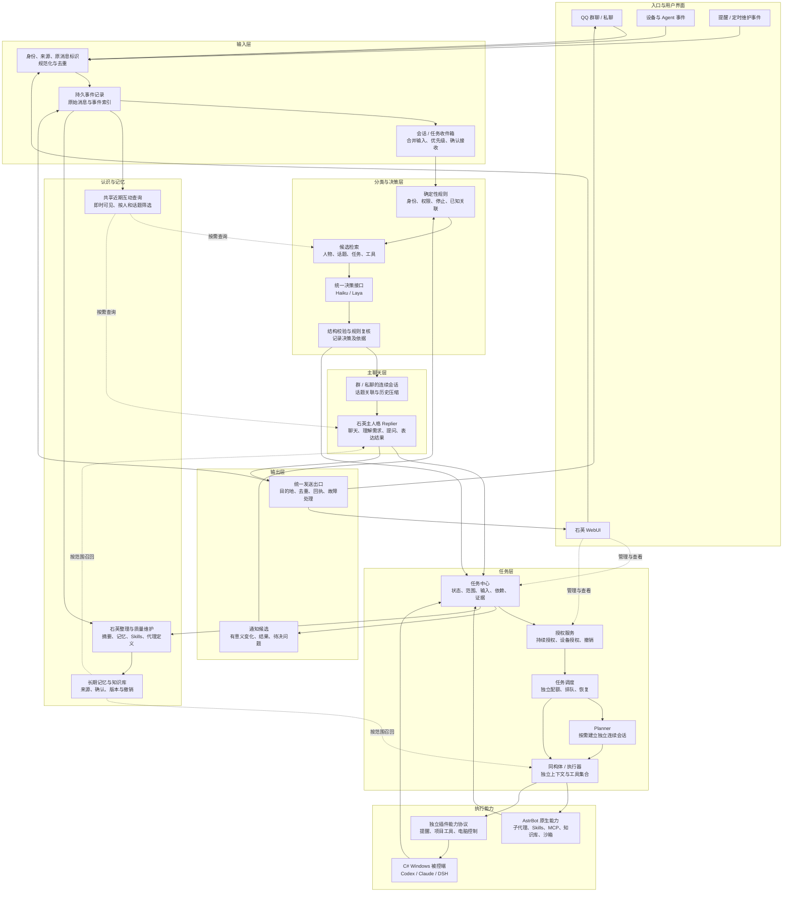
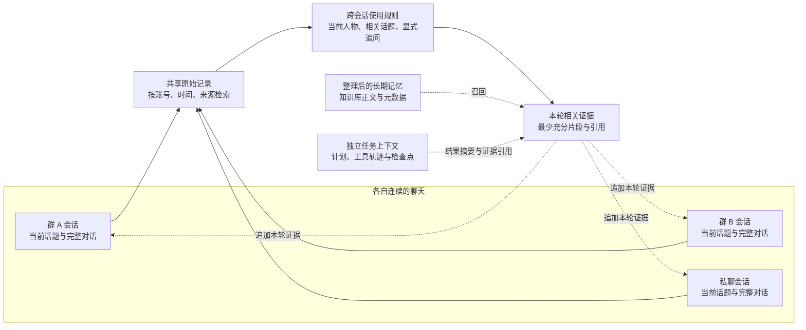
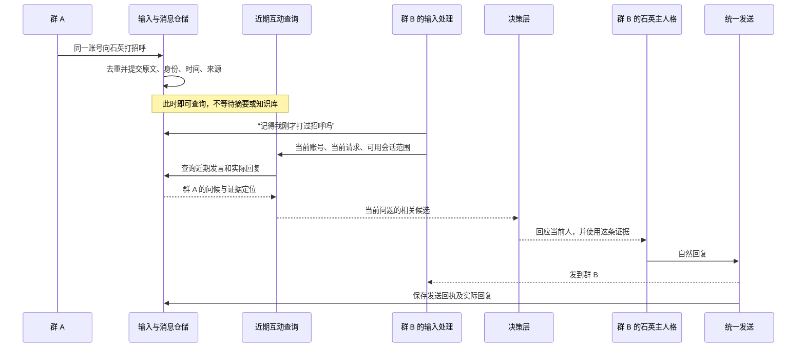
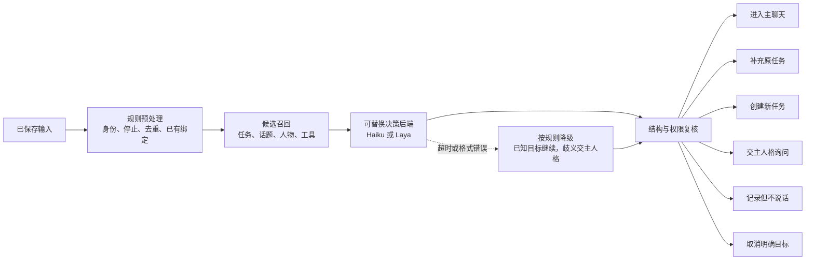
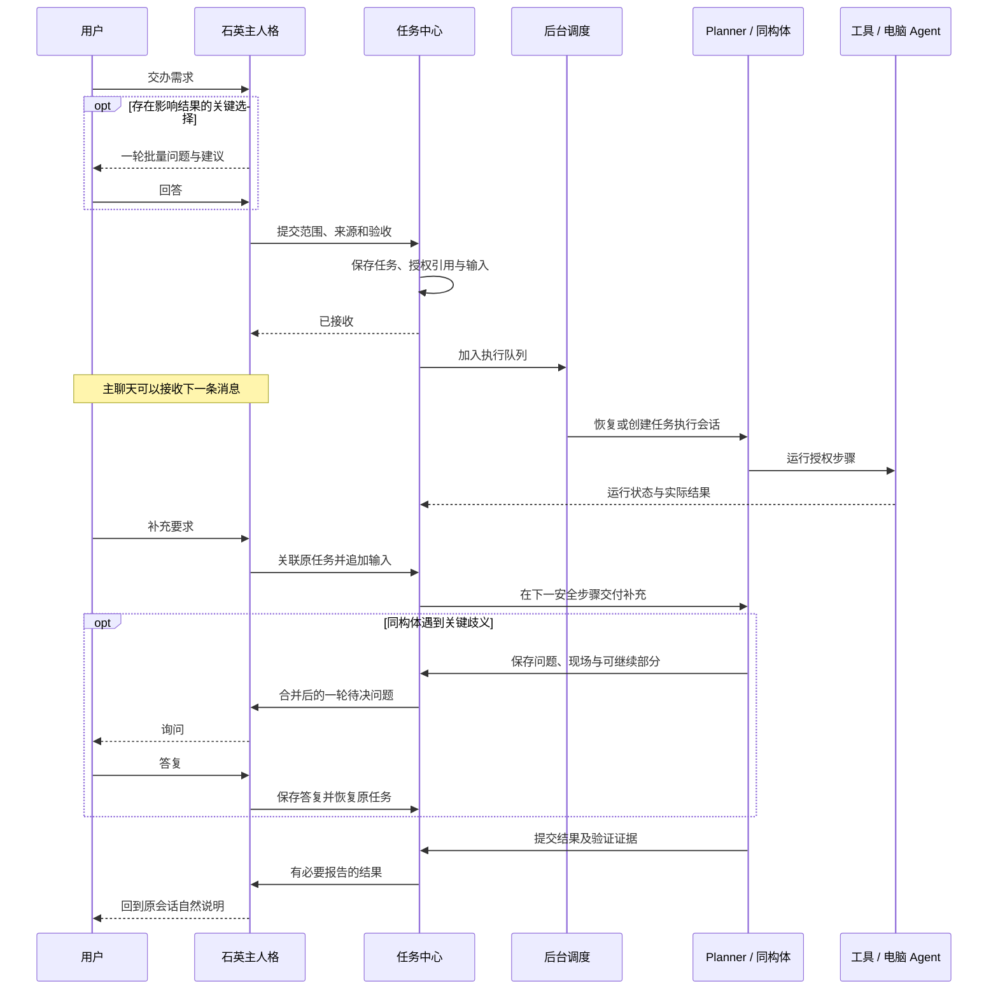
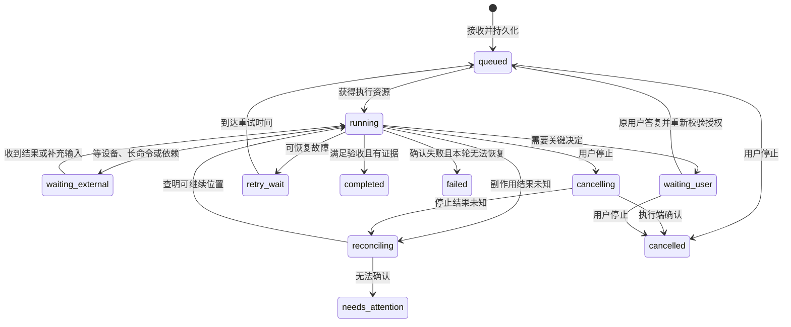
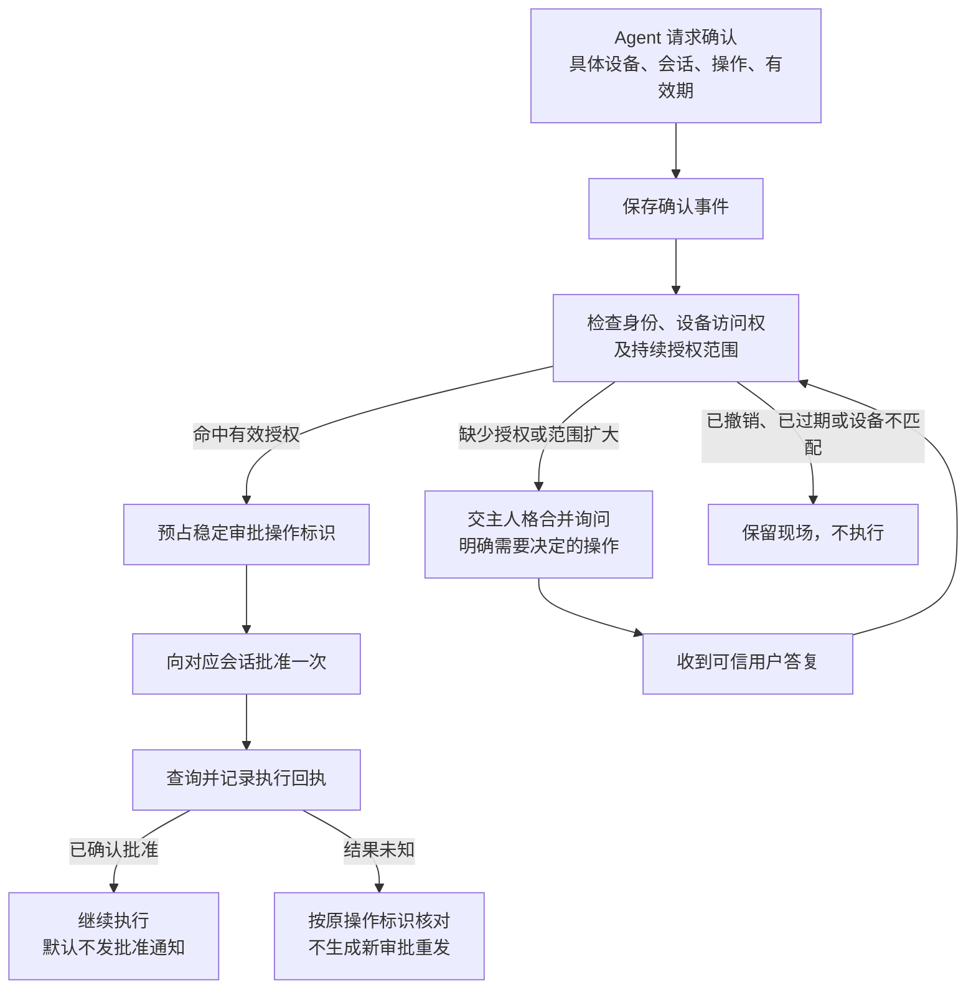
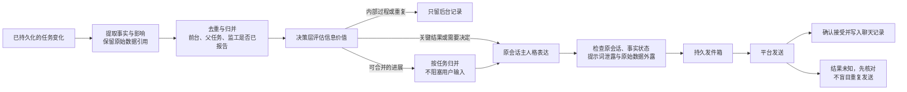

# 石英 Agent 分层与连续会话改造计划

状态：设计选择已定，分阶段实施中。阶段 0.5、持久任务输入及任务状态／执行尝试拆分已有单元与 AstrBot 4.29.4 宿主测试，完整方案尚未实施，进度见第 12 节。

更新日期：2026-11-14。

本文描述目标架构、行为约定、接口方向、实施顺序和验收标准。标为“已确定”的内容来自本轮讨论；第 14 节建议默认已获确认；具体实现状态以第 12 节进度为准，未完成项仍是目标设计。

现有代码约束见 [架构说明](architecture.md)、[自主开发约定](development.md) 和 [插件通信协议](plugin-protocol.md)。实施时同步修订这些约定，避免新旧规则同时指导石英自主开发。

第 2.1–2.3 节已并入 2026-11-13 的源码复核：本仓库 `3f9112e`，宿主 AstrBot `v4.29.4`。复核只读源码，未运行；标为推断或待核对的条目仍需实测。

## 1. 目标与设计边界

石英应当具有连续的聊天体验，能记得刚在其他群发生的相关互动，能自主规划并执行长任务。任务排队、工具等待、授权处理和错误恢复不应占住主聊天，也不应变成不断刷到 QQ 的技术报告。

### 1.1 已确定的行为

| 事项 | 约定 |
| --- | --- |
| 主人格 | 保留石英人格，使用自然的日常交流方式；可以把子代理称为“同构体” |
| 决策模型 | Laya 与 `shrink/claude-haiku-5-5` 属于同一分类与决策层，通过同一接口使用 |
| 开发模型 | 开发同构体使用已配置的 `gpt-6.1-sol`；其他执行器保留各自已配置模型 |
| 长任务 | 从主聊天分离；支持补充指令、取消、恢复和持续监工，不设整项任务的统一墙钟截止时间 |
| 自动批准 | 用户明确给出的持续授权需要保存并实际执行；范围内静默批准，不反复询问 |
| 通知 | 不要求每次工具调用、派工、重试或批准都报告；按实际信息价值决定是否发送 |
| 错误 | 可恢复故障先自动恢复；不把错误堆栈、工具 JSON、提示词和上下文直接发到聊天 |
| 跨群认识 | 可以召回同一个人在其他群的全部相关发言，包括他对其他人说的话 |
| 私聊延续 | 本人在群里明确追问相关私聊内容时，可继续该话题，不再额外询问是否允许转述 |
| 即时性 | 刚收到的互动应立即可查，不等待向量化、摘要或夜间整理 |
| 长期记忆 | 资料经过石英筛选整理后入库；近期原始记录不自动变成长期事实 |
| 插件边界 | 核心不导入电脑控制、提醒、CraftTable、Gitea 等独立插件实现 |
| 自主开发 | 子代理能使用分配到的记忆、知识库、Skills、插件、MCP 和沙箱；新增对外回复必须遵守统一表达与发送契约 |
| 架构调整 | 允许破坏性变更，但必须备份、迁移、验证并提供恢复路径 |
| 旧数据 | 现有数据必须能迁移到新版结构；迁移后与新数据同等使用，不加旧数据专用的标记字段或单独的过滤规则 |

### 1.2 已定的默认选择

- 主人格保留记忆查询、任务状态查询及少量快速工具；多步骤、有持续等待或明显副作用的执行交给任务执行器。
- 决策层先启用 Haiku，Laya 通过相同数据做对照评测后再选择启用范围；不让每条消息默认串行调用两个决策模型。
- 近期跨群关联自动按当前发言人和话题准备候选；明确追问时扩大检索范围。默认不持续推送所有其他群的新消息到每个会话。
- 聊天、规划与执行使用不同调度配额；后台执行初始复用现有的三路并发，后续按实测调整。
- 图中的角色是逻辑职责；简单任务可以直接交执行器，不必额外创建一个 Planner 模型会话。

这些默认选择已确认，与第 14 节共同作为实施基线。

## 2. 当前实现与问题依据

以下为本轮源码检查所见，不把设计文档中的承诺当作已经完成的功能。

| 当前实现 | 已观察到的问题／改造要求 |
| --- | --- |
| 核心在请求处理中重建聊天上下文，并清空宿主传入的历史上下文 | 要重新设计完整对话历史的归属，不能仅追加更多提示词模拟连续会话 |
| 现有上下文会查询同一人在其他会话最近 6 小时的最多 6 条记录；范围含此人在其他会话（包括私聊）的任何发言，以及石英对此人的回复 | 有跨群基础，但固定条数容易漏记录；原文直接混入上下文，任务跟进与外发表达两条路径跳过此查询；查询本身不区分私聊与群聊，尚未按 5.2 节的范围规则筛选 |
| 原始消息、人物、记忆、操作任务和通知已有数据库记录 | 优先扩展这些记录与关联，不为每个模型建立一套独立“事实库” |
| `shrink_orchestrate submit` 已使用后台任务创建方式返回 | 不能仅凭聊天阻塞就断定 submit 在同步等待；还需检查原生 handoff、轮询、共享事件和调度 |
| 后台子代理会使用原始宿主事件对象调用工具；前台的回复、工具记录和通知钩子已按当前任务标记跳过，发送钩子和后台工具对事件对象的直接操作未隔离 | 需要隔离执行事件与前台可变状态，避免后台改变前台的回复、工具记录或发送标记 |
| 核心的外发表达在工具结果类消息表达失败时返回原始内容（[outbound.py](../shrink/services/outbound.py#L22)）；电脑插件只在缺少表达能力时直接发送任务结果文本，表达出错时重试、不回退 | 原始结果应留在后台；表达失败不能成为原始 JSON 外发通道。要改的出口在核心，不在电脑插件 |
| 前台存在工具调用前的自动通知逻辑 | 改为按事件价值决定是否通知，不把“调用了工具”当作必须说话的理由 |
| 单次模型调用已有宿主重试机制 | 必须核对实际重试层级与预算，避免再套一层重试导致长时间占用和重复请求 |
| 运行日志出现 45 秒、55 秒的 sleep，以及多轮状态查询 | 必须补足前台／后台归属信息后定位；日志片段本身不能证明全部等待都来自主聊天 |

本次改造需要解决职责与状态的混用。仅调整口吻、增加超时或增加提示词，不能作为完成标准。

### 2.1 聊天排队与派工后迟迟不回话：专项核查

核查日期：2026-11-13；本仓库基线为 `3f9112e`，宿主源码按 AstrBot `v4.29.4` 核对。以下区分源码事实、日志观察和待验证推断；不代表修复已经实施。线上当前配置与安装源码仍需在阶段 0 核对。

| 机制 | 源码事实与影响 |
| --- | --- |
| 宿主按会话串行 | [宿主 internal.py:239](https://github.com/AstrBotDevs/AstrBot/blob/v4.29.4/astrbot/core/pipeline/process_stage/method/agent_sub_stages/internal.py#L239) 以 UMO 获取会话锁，锁内包括请求构建、插件请求钩子、整轮模型／工具循环及历史保存。相同 UMO 的其他正常轮次必须等待。锁的键只有 UMO：群聊默认整群共用一把锁，仅在宿主开启 `unique_session` 时按发言人分开。发送阶段也在这把锁内，见下文“发送也在锁内” |
| 输入事件本身可并发 | [宿主 event_bus.py:73](https://github.com/AstrBotDevs/AstrBot/blob/v4.29.4/astrbot/core/event_bus.py#L73) 为事件创建独立 asyncio 任务；排队不能简单归因于全局事件总线逐条执行 |
| 前台执行边界缺失 | [conversation.py](../shrink/adapters/conversation.py#L312) 只登记取消用的运行任务，没有整轮墙钟截止时间；当前请求未筛除宿主 shell、python、shell session 和同步 handoff 工具。仅要求模型不要轮询，不能保证前台及时结束。`transfer_to_*` 出现在前台，是因为创建同构体时插件把宿主的 `main_enable` 设为开启（[agent_tasks.py](../shrink/adapters/agent_tasks.py#L186)）；同步 handoff 不受工具调用超时约束，是最长的占锁项 |
| 派工入口已异步 | [agent_tasks.py:233](../shrink/adapters/agent_tasks.py#L233) 用 create_task 启动后台执行后返回 queued；后台三路执行槽不等于前台会话锁。不能把所有延迟归咎于 submit 等待后台完成 |
| 新消息使旧生成失效，但未停止生成 | [debounce.py:64](../shrink/services/debounce.py#L64) 标记旧的未提交回复 superseded；[conversation.py:498](../shrink/adapters/conversation.py#L498) 到装饰发送结果时才丢弃。旧轮次仍会完成模型调用、表达收尾和可能的二次改写后才被丢弃，期间一直占用会话锁。旧轮次一旦用过聊天类以外的工具就不再被取代（[conversation.py](../shrink/adapters/conversation.py#L624)），同一人连发会得到两条独立回复 |
| 防抖与宿主在途补充叠加 | [宿主 follow_up.py:176](https://github.com/AstrBotDevs/AstrBot/blob/v4.29.4/astrbot/core/pipeline/process_stage/follow_up.py#L176) 仅把相同 UMO、相同发言人的新消息交给活跃 runner；新事件在锁外等待 ticket，等待没有超时。输入只在 runner 写入工具结果时被消费，附在工具结果文本之后；没有工具调用的轮次不会消费，新事件要等旧轮结束后按到达顺序另起一轮。被消费的事件之后不再触发任何插件钩子，插件先前创建的防抖记录因此残留，150 秒内同一人的下一条消息会把它再合并一次；交给 runner 的文本本身也是已合并的文本，旧轮会把原话再看一遍。runner 正常结束或被停止时释放未消费的 ticket，步骤内未捕获的异常路径不释放，新事件会一直等待；须通过集成测试验证 |
| 工具前通知增加串行模型调用 | [tool_notices.py:25](../shrink/adapters/tool_notices.py#L25) 在首个符合条件的工具执行前等待表达与发送；[outbound.py:51](../shrink/services/outbound.py#L51) 表达最多等待 30 秒，之后 [notifications.py:30](../shrink/adapters/notifications.py#L30) 发送还可等待 30 秒，最坏串行约 60 秒。只读工具也可能触发 |
| 工具结果还有表达开销 | [expression.py:113](../shrink/services/expression.py#L113) 对工具回复再次调用表达服务；普通短回复在过长或重复时也可能改写；出现没有证据的完成声明时还会再表达一次（[conversation.py](../shrink/adapters/conversation.py#L450)）。这些调用各有 30 秒上限，都在会话锁内。主模型耗时不能代表完整响应耗时 |
| 请求重试延长持锁时间 | [宿主 internal.py:156](https://github.com/AstrBotDevs/AstrBot/blob/v4.29.4/astrbot/core/pipeline/process_stage/method/agent_sub_stages/internal.py#L156) 默认请求尝试预算为 5；实际值来自配置。单次请求超时默认 120 秒，另有最多 3 次空输出重试，备用模型逐个从头尝试，各层相乘。这些参数在插件钩子运行前已绑定到 runner，插件无法按请求覆盖。OpenAI 源内还有一层外层重试循环，范围待核对 |
| 防抖是固定延迟 | [debounce.py:37](../shrink/services/debounce.py#L37) 每条消息进入宿主流程前先等安静窗口，默认 1.5 秒、最长 6 秒；在锁外，但计入每条回复的时延 |
| 上下文准备在主模型之前串行执行 | 记忆 embedding 8 秒、知识库检索 10 秒、带锁的重排 20 秒、Skills embedding 8 秒，上限相加约 46 秒，均在会话锁内；实际分布待埋点 |
| 发送也在锁内 | 宿主在 agent 阶段让出执行时运行后续发送阶段，仍持有会话锁。[conversation.py:565](../shrink/adapters/conversation.py#L565) 发送钩子里的 1–2 秒等待、第二气泡、表情发送，以及宿主的分段回复间隔都占锁 |
| 现有停止逻辑直接取消任务 | [conversation.py:213](../shrink/adapters/conversation.py#L213) 对运行任务调用 cancel。[宿主 context_utils.py:120](https://github.com/AstrBotDevs/AstrBot/blob/v4.29.4/astrbot/core/pipeline/context_utils.py#L120) 捕获的是 BaseException，取消落在插件钩子内会被吞掉；已挂起的 follow-up ticket 也不会因此释放。现有测试使用假任务，覆盖不到 |

本地运行日志中的可确认观察：

- 存在同群 follow-up 捕获、消费以及 shell 轮询；也存在 45 秒、55 秒的 Python sleep。日志缺少逐次调用的前台／后台运行标识，不能据此把所有 shell 或 sleep 认定为前台执行。
- 记录到模型超时重试和备用模型切换，以及两次“新消息接管，丢弃旧回复”。这些支持存在重试与无效生成开销，但不能从混杂日志精确分摊各轮耗时。
- 00:03:07 收到“活着没”，00:09:52 出现对应答复，表观间隔约 6 分 45 秒。缺少完整运行关联，不能把其中某段精确认定为生成时间、其余全部认定为锁等待；先前“本轮只用 14 秒”的判断不作为已核实事实。
- 相邻超时日志不能证明单次请求的超时配置；实际超时与重试参数须从线上配置读取。

### 2.2 修复边界与落地要求

1. 在前台请求钩子里，从当前请求的工具集筛除 `astrbot_execute_shell`、`astrbot_execute_python`、`astrbot_shell_session` 和 `transfer_to_*`，保留快速查询与后台派工入口。
   - 宿主执行工具时只查当前请求的工具集，钩子之后不再追加工具，筛除即生效。被筛工具若仍被模型点名，会得到“工具不存在”并白耗一轮模型调用。
   - `transfer_to_*` 优先通过不再开启宿主 `main_enable` 去掉；后台提交同构体是否受影响须在线上确认。
   - 请求系统提示和 Skills 规则里对这些工具的引用同步去掉；需要运行脚本的 Skills 改走后台任务。
   - 名单按线上运行时确定，沙箱运行时的工具名不同。联网搜索、工作台测试、MCP 等其他可能长期等待的工具也需盘点。
   - 仅修改当前请求的工具集：不把工具集筛空，不修改工具对象的全局启用状态，不影响后台工具集。
2. 新消息替代旧生成，分两步做。本项只对同一发言人生效；同群不同人的排队靠第 1、5、6 项缩短持锁时间。
   - 先做：旧轮还在等锁或在上下文准备阶段时，进入请求钩子即检查是否已被取代，是则结束事件传播，宿主在注册 runner 前退出；已被取代的轮次在回复钩子里跳过表达与改写。
   - 后做：停止已注册 runner 的旧轮。不直接 cancel 运行任务，原因见 2.1“现有停止逻辑直接取消任务”：取消可能被吞，已挂到旧 runner 的 follow-up ticket 不释放，新事件及其后同 UMO 的 follow-up 会一直等待。须先给旧事件设置停止请求以阻止新的 follow-up 捕获，再走宿主的协作停止。宿主停止时会往历史追加一对停止消息，并中断进行中的工具；这两点须在集成测试中确认可接受后才上线。现有“停”指令的取消逻辑按同样方式改。
   - 工具“已经开始”必须在执行前记录：在工具前钩子开头、任何等待之前同步标记，不能只根据工具返回后的记录判断无副作用。该钩子只能记录，不能拦截。已有工具执行或写入结果未知时，不直接取消并重放。
3. 宿主消费 follow-up 后，按输入标识结束对应防抖记录；未消费则只恢复一次。
   - 插件收不到“已消费”的回调。建议把回复记录的清理挂到该事件处理任务的结束回调上，一并覆盖消费、取消与异常；清理按记录身份比对，旧事件不会清掉新事件的记录。
   - 同一人已有活跃 runner 时，不把合并后的文本写回新事件，避免旧轮重复看到原话。
   - ticket 不释放的异常路径需要兜底超时。
4. 去掉强制工具前通知及对应提示词，同步修订 development.md 中“工具调用前一轮最多一条提示”的约定。工具前钩子保留，改为第 2 项所需的同步标记。真正需要发送的结果仍按统一通知策略处理；不以秒回占位消息替代响应延迟修复。
5. 核对宿主聊天模型单次请求超时、总尝试次数、空输出重试及备用模型切换策略，按前台时延目标单独配置；后台继续保留持久恢复能力。
   - 插件无法按请求覆盖这些参数。可行做法是给前台单独建一个低超时的 provider 条目，并降低主 agent 的请求尝试预算。
   - 后台调用不传这些参数，不受主 agent 配置影响；但与前台共用同一 provider 条目时会受其超时影响。
   - 工具调用超时（默认 120 秒）也计入前台预算。
   - 具体参数由阶段 0 实测确定，不假定改本仓库即可更新线上宿主配置。
6. 把第二气泡、表情等附加发送移出会话锁，改为后台发送并保留回执记录；评估上下文准备各步能否并行或缩短上限。

实施顺序：先埋点；再做第 5 项和第 1 项；然后第 4、6、3 项；第 2 项先做“提前退出”，停止运行中的 runner 待集成测试通过后再做。预期收益最大的是第 5、1 项，风险最高的是第 2 项；收益判断来自源码核查，须以埋点后的实测为准。

**工具拦截不能依赖 before-tool 钩子抛异常。** [宿主 context_utils.py:120](https://github.com/AstrBotDevs/AstrBot/blob/v4.29.4/astrbot/core/pipeline/context_utils.py#L120) 会捕获钩子异常，[runner:1279](https://github.com/AstrBotDevs/AstrBot/blob/v4.29.4/astrbot/core/agent/runners/tool_loop_agent_runner.py#L1279) 也会记录 on_tool_start 异常后继续执行。应验证请求工具筛选确实影响执行器查找；不能用单独的钩子单元测试宣称已阻断执行。

这些局部修复优先缩短前台占用、减少无效生成，不移除宿主相同 UMO 的串行语义。阶段 2 仍需验证独立聊天调度与宿主锁的边界；不得直接去锁导致历史覆盖、输入重复消费或多路发送。

### 2.3 与现有约定和实现的衔接缺口

以下为同一次复核中对照现有文档、表结构和测试所见，需在阶段 0 逐项处理。

| 缺口 | 现状 | 需要补的内容 |
| --- | --- | --- |
| 宿主锁与历史归属 | 回复走宿主 agent 阶段，同 UMO 串行；核心每轮清空宿主历史后自行重建上下文 | 阶段 1 的会话历史取决于“是否继续走宿主 agent 阶段、历史由谁写”。这个决定提前到阶段 0，并写明改用宿主原生历史失败时的回退路径 |
| 决策层 | 仓库内没有 Laya 或 Haiku 的接入点，是否参与由规则决定。唯一的评测文档 local-judge-model.md 评的是 Qwen3.5-2B，未纳入版本库，12 个样本中漏判的两条是开发任务识别 | 说明 Laya 与已评测模型的关系；给出决策调用在关键路径上的时延预算，以及规则层预期能直接处理的比例 |
| 授权数据归属 | 核心没有授权表；设备授权与逐次批准在电脑接入插件内，核心只转发和展示 | 第 8 节要求核心保存并执行持续授权，10.3 又规定核心不实现电脑协议。先确定授权记录与批准动作各归哪一方 |
| 任务状态映射 | 现有状态含 `waiting`、`awaiting_input`、`interrupted`、`timed_out`、`blocked`、`testing`、`deploying`、`awaiting_deployment`；没有 `retry_wait`、`reconciling`、`cancelling`。启动时把在途任务批量标为 `interrupted`（[operations.py](../shrink/adapters/operations.py#L44)）；重试是内存内循环，没有持久的重试时间 | 给出新旧状态映射表；重写启动恢复逻辑；部署链的状态单独说明 |
| 已有实现 | `ask_user`／`resume`／`answer` 与父任务合并提问、投递状态（含发送未知不重发、重启后不自动重放）、夜间维护的引用保护与 30 天恢复期均已存在 | 7.5、9.3、11.2 中这些内容按“对齐与扩展”处理，不重复建设 |
| 分层 | 任务表和状态机建在 adapters 层，与 architecture.md “persistence 保存 SQL 和状态”的分层不一致 | 任务中心、收件箱、授权服务放在哪一层；是否先把任务状态机移出 adapters |
| 工作台检查器 | 检查器比对统一通知运输代码，development.md 禁止草稿放宽检查 | 统一通知与发件箱改造不能由石英自主完成，须由维护端先调整检查规则 |
| 现有文档冲突 | development.md 规定“工具调用前一轮最多一条提示”；deployment.md 写主会话 100 秒预算、每任务 30 分钟，代码里已不设时限；`record_sent` 是 `message.compose` 的一个动作，不是独立能力 | 在阶段 0.5 之前列出逐条修订清单，避免旧规则继续指导自主开发 |
| 测试底座 | 单元测试对宿主全部使用模拟对象；真实宿主只有容器内手工运行的探针，不经过会话锁和 follow-up；没有通用的假发送器 | 搭建容器内可并发投递事件的真实宿主测试驱动，否则 C10–C14、T06 无法验证 |

任务状态映射与分层缺口已于 2026-11-14 按本轮范围补齐：SQL 在 persistence，状态／尝试／恢复规则在 services，映射与重试层数见 architecture.md。上表其余缺口仍按各阶段推进。

## 3. superagent 的参考方式

参考项目为 DeepSeek 的 `dsh-superagent-prototype`。其文档声明是研究原型；这里只借鉴经过核对的设计概念，不直接迁入其全部运行规则。

| 参考概念 | 石英中的对应设计 |
| --- | --- |
| Source / Trigger | QQ、WebUI、电脑事件等入口，以及统一输入事件 |
| Thread | 群聊、私聊与有明确关联的话题 |
| Ticket | 用户交办的任务，拥有自己的状态与证据 |
| Mandate | 可检查、可撤销且带来源的授权记录 |
| Assignment / Executor Session | 一次执行尝试与任务对应的持续执行会话 |
| 持久输入与结果回传 | 补充指令收件箱、执行事件和通知发件箱 |

采用“任务身份不等于 Agent 进程身份”“记录后执行”“后续消息能进入原任务”“上下文不自动授予权限”的设计方向。石英不沿用参考项目的全部超时、自动恢复和执行权限设置，也不采用一个全局模型窗口容纳所有群聊。

## 4. 总体架构

### 4.1 系统分层图

实线表示控制或数据传递；虚线表示按范围查询或管理。任务记录和授权检查由程序执行，模型输出不能直接修改真实执行状态。

### 4.2 组件职责与禁止跨越的边界

| 组件 | 输入与输出 | 不能承担的职责 |
| --- | --- | --- |
| 入口适配器 | 平台事件转成带可信身份的输入；保存原始定位信息 | 不能从模型参数读取“我是管理员” |
| 收件箱 | 已保存输入转成待处理批次；记录领取与消费位置 | 不删除尚未执行的补充指令，不把新消息当成已完成工作 |
| 决策器 | 给出路由、关联、工具候选与通知建议 | 不直接执行工具，不授予权限，不写入长期事实 |
| Replier | 连续对话、批量澄清、读取必要证据、表达给用户 | 不循环 sleep 监工，不持有长任务的等待循环 |
| 任务中心 | 管理任务事实、原会话、创建者、依赖与执行尝试 | 不从模型说“完成了”推断任务成功 |
| Planner | 按任务复杂度拆分工作，汇总同构体问题与结果 | 不把其他会话的历史任务恢复成当前待办 |
| 执行器 | 在授权范围内使用分配工具、处理失败并汇报事实 | 不绕过范围读取记忆，不直接向用户刷过程消息 |
| 授权服务 | 核验操作、作用对象和授权状态，记录批准 | 不把聊天记忆、网页或工具输出当作新授权 |
| 统一输出 | 判断目标会话、合并与去重、记录真实发送结果 | 不在失败时倾倒原始上下文，不把平台接受说成用户已读 |

## 5. 连续会话与跨群认识

### 5.1 三类上下文

1. **聊天上下文**按群、私聊维护，保存真实 user / assistant / tool 角色与顺序；话题关联用于选择注意力和定位任务。
2. **共享近期互动**查询已经保存的原始记录。它是及时认识人的渠道，不是等待模型写出的另一份摘要。
3. **任务上下文**按任务独立保存，包含计划、输入、工具调用、已知副作用和恢复位置。需要时向聊天提供结果和引用。

长期记忆仍是经过整理的事实；问候、临时讨论和过程日志不因进入近期记录就成为长期事实。

### 5.2 身份与范围

- 会话身份至少区分机器人实例、平台、群／私聊类型和平台会话标识。
- 人物身份使用平台账号；昵称、备注和群名只作展示及检索线索。不同平台账号不自动视为同一人。
- 跨群检索默认服务当前发言人及当前话题，允许使用此人在其他群的相关发言；不自动扩展成所有群成员的完整记录。
- 本人在群里明确追问私聊话题时，可以带入回答该问题所需的私聊片段；这不意味着今后的全部私聊都可主动公开。
- 其他人问起某人的私聊时，不因此获得同样范围。
- 跨会话证据携带来源与说话人，不能把 A 群第三人的话归到当前发言人名下。
- 跨群知道任务存在，不代表当前会话具有执行、批准或接收完整任务结果的权限。

### 5.3 即时可见与检索

收到消息时，在原始记录事务中同时保存可查询的账号、会话、时间与消息关联。索引提交后，后续回复可直接查询；摘要、嵌入、重排和长期记忆写入异步进行。

近期互动不是独立可编辑的正文库。优先复用已有消息表并补充索引与查询服务，避免两个来源内容不一致。

检索分两路：

- **自动准备候选**：针对当前账号与当前话题，提取少量相关事件。普通闲聊不自动带入此人在各处的所有活动。
- **显式追问检索**：对“刚才聊过吗”“我在另一个群说的那个”“继续刚才私聊的事”等问题，按身份、时间、引用及话题扩展查询。

固定 6 条不能作为唯一检索入口。超过即时上下文预算时，提供时间范围、候选摘要与可继续读取的引用；不得将“未选进上下文”表述成“没有发生”。

决策模型可以帮助理解“问候”“同一话题”等语义，但原始记录的写入和按账号查询不依赖模型完成。如果语义判断超时，仍可查询近期直接往来，回答已知部分。

### 5.4 跨群问候时序

验收要求：A 群消息已被系统接收并提交后，B 群下一次相关推理可查到。若平台尚未交付 A 群消息，则状态为尚未观察到，不能声称已经看过。

### 5.5 上下文、压缩与缓存

- 不再每轮清空全部宿主历史后，仅用截断的聊天文字重新模拟对话。
- 首先验证 AstrBot 当前版本能否提供所需的会话历史、工具消息与恢复能力；满足则通过适配器复用。不满足的持久字段由核心补充，避免两套历史同时写入。
- 人格、固定工具契约和公共规则保持稳定；本轮检索材料作为新消息或工具结果追加，不反复插入系统提示前缀。
- 每个会话保存压缩检查点、覆盖事件范围和原始引用；压缩后仍可恢复相关细节。
- 新事件只推进受影响的会话和任务，不重建所有会话上下文。
- 模型服务是否实际命中提示缓存，以运行指标验证；连续历史与稳定前缀只是支持条件，不承诺必然命中。
- 撤销、纠错或授权改变需要追加明确的新状态；旧上下文不能继续当作当前事实使用。

## 6. 决策层：规则、Haiku 与 Laya

### 6.1 决策流水线

决策器处理：

- 是否被叫到、是否接着已有话题、是否需要回应。
- 这是聊天、查询、任务、补充指令、停止、授权指令还是通知事件。
- 是否能绑定明确已有任务；模糊指代需要查证或询问。
- 简单任务直接派执行器，复杂任务是否需要 Planner。
- 从当前实际可用且符合范围的能力中返回候选。
- 后台变化应该忽略、合并、稍后报告还是立即交主人格表达。

决策器不处理完整代码实现、长期记忆整理或原始日志分析。输入只包含判定所需的上下文和候选，避免分类器自身变成另一个拥挤的主模型。

### 6.2 统一输出契约

建议决策结果包含以下逻辑字段，具体数据类型在实现准备阶段固定：

| 字段 | 含义 |
| --- | --- |
| intent | 聊天、查询、任务、补充、停止、授权或后台事件 |
| route | 回复、创建任务、附加到任务、询问或静默 |
| conversation / topic / task | 程序提供的候选标识；模型不得创造不存在的任务 |
| evidence | 支持判断的输入事件引用 |
| capability_candidates | 实际目录中的能力与建议顺序 |
| notify | 静默、合并、普通结果或需要用户行动 |
| confidence | 判断把握，用于回退与评测，不作为权限依据 |

Laya 返回的概率与 Haiku 返回的自评把握不能直接当成同一种校准概率比较。接口统一不意味着原始分数可互换；以同一评测集的实际分类与路由结果比较。

工具候选的建议初值为最多 5 个。目录检索无命中或模型无法区分时，允许进一步发现；不能因为候选截断就把存在的能力判断为不可用。

### 6.3 失败与降级

- 已知会话、身份和任务关联由规则提供，模型不能覆盖。
- 明确停止指令优先处理；目标不明只询问目标，不取消所有历史任务。
- 决策模型不可用时，私聊或明确叫到石英的消息仍可进入主人格；无明确需求的群聊插话保守保持静默。
- 分类失败不能丢失收件箱输入，重试使用同一事件标识。
- 未验证 Laya 的接口、时延和准确率前，不让它成为主聊天可用性的唯一依赖。

## 7. 主聊天与任务执行分离

### 7.1 任务派发和继续

### 7.2 连续输入与防抖

- 原始消息到达即保存，防抖只影响何时消费，不影响记录可见性。
- 同一发言人、同一会话的一小段连续输入可合并；不同发言人的指令不能误合并成同一授权。
- 明确停止与授权撤销不等待普通防抖窗口结束。
- 回复生成中又收到补充时，未产生副作用的回复草稿可重新生成；已启动任务的新增要求作为任务输入追加。
- 补充输入使用稳定标识，保存已领取、已进入执行上下文和已处理的位置。进程重启后只补交尚未消费的输入。
- 新话题不自动打断已提交后台任务；用户明确停止或替换任务时按相应操作处理。

### 7.3 消除主聊天阻塞

- 主聊天不通过 shell sleep、Python sleep、同步 handoff 或循环轮询等待任务完成。
- 派工接口完成持久化后立即返回，不等待 Planner、测试、外部 Agent 或最终表达。
- 任务状态查询只返回当前快照；持续监工交给后台订阅或定时检查。
- 主人格与 Worker 使用独立事件上下文。Worker 不共享前台的可变宿主事件、回复对象、取消标记或工具列表。
- 后台 Worker 的工具输出进入任务记录，只有通知候选进入主人格。
- 共享的网络连接、模型并发限制和数据库访问也要检查；仅创建 asyncio task 不代表完成隔离。
- SQLite 事务中不等待模型、网络或工具；同步计算与阻塞 I/O 需移出事件循环。
- 后台结果表达排在新用户输入之后；授权撤销、停止及需要用户处理的阻碍具有明确优先级。

### 7.4 任务状态与恢复

任务业务状态、一次执行尝试的状态、通知状态分别保存，不能共用一个“完成”字段。

恢复时保留任务身份、原会话、授权引用、执行器原生会话和已完成步骤。执行会话无法接管时明确标记，不创建新进程冒充原任务仍受控。

任务失败可保存现场等待后续处理；不因单次故障重新创建整个任务，也不在进程启动后自动复活用户已停止的工作。

### 7.5 自主开发与提问

- 开发前读取当前架构契约及适用 Skills，确认版本、草稿基线和已有测试。
- `grilling` 只用于用户需要讨论实现细节的任务，按当前已具备前提的问题批量询问；能从文件与工具查明的事实由代理自己查。
- 用户明确要求直接做时，跳过可以自行决定的细节，不重复访谈；新增权限或不可恢复操作仍按原有授权边界处理。
- 同构体遇到关键歧义时保存现场并交 Planner 合并问题，再由主人格向原用户询问。独立分支可继续，依赖该答案的步骤暂停。
- 工作台支持新建与修改插件；部署、热重载、冷重载仍使用独立执行器和真实回执。
- 修改核心或独立插件都必须通过架构与通知契约测试，不能通过修改检查器来绕过要求。

## 8. 持续授权与自动批准

持续授权属于可查询的运行数据，不只是一条长期记忆或模型提示。

建议授权记录包含：授予者、原始指令引用、被授权管理员、设备或资源、任务或会话范围、允许的操作类别、有效期／持续有效状态、版本及撤销记录。

- “以后不要再问”需要转换成用户实际表达的范围，并给出可查看和撤销的记录；不能默认扩大成任意设备、任意管理员和任意操作。
- 同一任务内已明确授权的常规执行，不应由于底层协议只能“批准一次”而再次询问。程序可以按持续策略逐次批准，每次都留下审计。
- 被授权管理员的设备访问权与自动批准策略分别检查；撤销设备访问后，其策略不能继续生效。
- 自动批准不修改任务原始回传会话，不因为另一管理员有设备权限就把结果转发给他。
- 需要用户决定的问题必须绑定具体任务及确认对象。“同意”不能误批另一个任务的操作。
- 权限新增、业务数据删除等超出已有授权的操作，仍回到原会话说明具体差异。

## 9. 统一表达、通知选择与错误恢复

### 9.1 统一表达的定义

统一的是人格、可信上下文、事实来源与发送契约。建议由主人格负责最终对外表达，普通聊天不强制经过第二次完整模型改写。

后台插件提交结构化事件和可读结果，主人格按需要表达。日常回复默认说明用户关心的变化；只有用户明确要求排查、代码或详细日志时才展开必要信息。

例如：

- 实际已派工：“我让我的同构体去看看，有结果再回你。”
- 代码已写而测试环境阻塞：“插件写好了，测试环境这边还卡着，我处理完继续。”
- 临时错误已恢复：通常不单独报告。
- 结果尚未确认：“这一步还没确认，我先核对一下。”

例句不是固定模板。“我会继续”只能在确有待执行任务或重试安排时使用，不能用来掩盖任务已经停止。

### 9.2 通知选择

默认安静的事件：调用工具、读取文件、普通日志增加、自动批准、可恢复错误、无新内容的仍在运行、子任务内部交接。

需要考虑报告的事件：用户主动查询、有用结果、实际完成、改变预期的阻碍、需要用户决定的操作、停止或恢复结果。

“任务返回了一个文本”不等于有必要再发一条；“用户没有收到每一步进度”也不等于结果丢失。

### 9.3 输出失败

- 原始结果先持久化，表达服务失败不能导致结果丢失。
- 可恢复的表达错误重试，但不重新执行原工具或整项任务。
- 表达仍失败时，非必要进度保持安静；必要结果使用由已知状态生成的简短说明。
- 不使用“原始 facts”“完整事件 body”“模型异常全文”作为用户消息的兜底文本。
- 结构化的静默决定有独立状态，不能被调用方当成空字符串错误后回退到原始 JSON。
- 每条通知使用稳定标识并记录关联事实；前台答复、父任务汇总和设备监工共享去重关系。
- 已确认平台接受后才将文本加入实际对话记录；发送结果未知保持未知，不伪造已发送。

### 9.4 重试策略

| 故障 | 处理方式 |
| --- | --- |
| 网络中断、连接超时、限流、可恢复服务端错误 | 按单次请求退避重试，保留任务；后台等待不占聊天执行资源 |
| 参数不合法、工具不存在 | 查当前接口、工具目录及参数，修正后再调用；不原样循环 |
| 工具写入结果未知 | 查询状态、回执或目标对象，再决定是否恢复；复用原操作标识 |
| 权限不足、明确拒绝 | 停在对应操作，不通过重试绕过；核对是否已有有效授权 |
| 输出格式错误 | 在读取／表达环节有限修复，不把格式问题扩大为整项任务重跑 |
| 长命令仍在运行 | 保存句柄并订阅或后台检查；不以 sleep 保持前台工具链 |
| 平台发送结果不明 | 先核对记录；无法确认时进入待核对状态 |
| 持续不可用 | 保存检查点、重试历史与具体阻碍，必要时给主人格一条可读状态 |

建议每个单步自动重试最多 3 次，次数可配置；这是单步恢复预算，不是整项任务时限。接入前先核对宿主、SDK 和适配器已经发生的重试次数，避免多层相乘。记录下一次执行时间，不用长时间占住锁或协程执行槽。

## 10. 数据所有权与公共接口方向

### 10.1 核心实体

| 实体 | 保存内容 | 重要关联 |
| --- | --- | --- |
| 输入事件 | 原消息或外部事件、身份、来源、时间、去重标识 | 会话、人物、任务、引用 |
| 会话与话题 | 连续历史、当前话题、压缩检查点、消费位置 | 原始消息与相关任务 |
| 决策记录 | 后端版本、候选、路由、依据、降级原因 | 输入事件 |
| 任务 | 用户目标、范围、验收、创建者、原会话、依赖、状态 | 授权、输入、执行尝试 |
| 执行尝试 | 执行器与原生会话、步骤、句柄、重试、检查点 | 同一任务可有多次尝试 |
| 授权与确认 | 授予来源、范围、版本、有效状态、具体审批 | 管理员、设备、任务、操作 |
| 通知 | 事实引用、是否发送、表达文本、目标、回执 | 原输入、任务、具体变化 |
| 记忆关联 | 人物、来源、确认、置信度、版本、撤销 | 知识库正文 |

新增结构优先通过现有仓储扩展。操作事实、模型摘要和最终回复分开保存；不能用某一个字符串同时代表三者。

### 10.2 能力协议

保留 `shrink_orchestrate`、`shrink_develop`、`shrink_lookup` 等现有入口的兼容语义，内部切换到新的会话和任务服务。

拟增加／扩展的逻辑能力：

| 能力 | 行为方向 |
| --- | --- |
| 近期互动检索 | 按可信调用身份、当前会话、问题与事件引用查询；范围由程序生成 |
| 任务输入追加 | 向已有任务交付补充、答复或取消；返回持久接收状态 |
| 任务状态／订阅 | 查询快照或登记监工；不阻塞直到完成 |
| 持续授权管理 | 查看、设置与撤销明确范围的策略；保留真实授权证据 |
| 统一通知提交 | 外部插件提交事实、原会话、稳定事件标识和消息类型 |
| 表达兼容入口 | 保留 `message.compose` 文本调用方式，增加明确的静默／可发送结果语义 |
| 发送记录 | 保留已接受消息的回执登记；不能把“生成了文本”记为已发送 |

新调用方优先使用统一通知提交，由核心统一排队、去重和表达。旧插件可通过兼容适配器继续使用 `message.compose` 与 `record_sent`，迁移期间每类事件只能有一个发送所有者，避免双发。

能力提供者仍保留业务权限检查。所有公开接口的会话、创建者与权限来自入口或持久任务，不能从模型传入的 JSON 获得管理员身份。

### 10.3 原生能力与独立插件

- 复用 AstrBot 的提供者、工具目录、MCP、Skills、知识库、沙箱、未来任务与插件加载；只补不足的协调和持久化能力。
- 核心不实现 Codex／Claude／DSH 协议；电脑接入插件与 C# 被控端负责实际会话控制和本机回执。
- 提醒插件持有未来任务与发送重试，核心只接收其通知事实，不重新硬编码提醒业务。
- CraftTable、Gitea 插件负责账号、空间与 CLI 交互；项目资料由石英整理后进入记忆。
- 插件暂不可用时，相关任务给出真实阻碍，主聊天与其他能力继续工作。

## 11. WebUI 与夜间维护

### 11.1 WebUI

建议提供以下视图，均复用核心服务及可信管理员范围：

- **会话与话题**：当前连续上下文、压缩位置、本轮引用了哪些跨群记录；区分原始记录与整理后的记忆。
- **决策轨迹**：输入、选中话题／任务、候选工具、使用的模型、是否降级及通知选择。
- **任务中心**：目标、原会话、执行器、输入队列、依赖、检查点、工具结果、待决问题和恢复操作。
- **授权管理**：设备访问权、持续自动批准策略、具体操作记录、暂停与撤销。
- **通知记录**：待合并、已抑制、已发送、发送未知及对应事实；日常操作不要求手填内部 ID。
- **能力管理**：插件、MCP、Skills、子代理和知识库的增删查改及使用情况。

保持 HTTP 映射兼容；已有鉴权、请求来源限制和幂等提交不能因 UI 改造被取消。原始 JSON 作为后台可展开详情，不作为默认聊天内容。

### 11.2 夜间维护

沿用每日 Asia/Taipei 04:00 的维护目标，记忆、Skills 与子代理分别记录结果。它承担长期质量整理，不承担即时跨群同步。

- 有证据的可复用经验进入原生 Skills，保留适用条件和失败教训，不写死私人任务参数。
- 只自动维护可确认由石英创建或明确纳入托管的能力。
- 使用少、单次失败、暂时依赖不可用不能单独作为删除理由。
- 活跃、排队、等待答复、待恢复、待回传和被依赖的任务所引用能力受保护。
- 淘汰先退出运行，保留 30 天恢复期；清除前再次核对引用、保护和恢复请求。
- 不删除执行审计，不把维护结果例行刷到 QQ。

## 12. 实施顺序与 TODO

各阶段先满足退出条件，再切换下一阶段。持续授权、跨群规则和通知去重必须在生产切换前完成验证。

### 阶段 0：基线与边界

- [ ] 确认第 14 节的关键选择，固定本计划版本。
- [ ] 核对线上源码、配置、模型、提示词覆盖项、活跃任务和各插件实际版本。
- [ ] 对比当前未提交改动，不将先前局部试改直接当成新架构的一部分。
- [ ] 给前台与后台执行补齐可关联的会话、任务和步骤观测方案。
- [ ] 验证 AstrBot 原生会话持久化、消息角色、输入追加和恢复能力，确定复用边界。
- [ ] 确定聊天回复是否继续走宿主 agent 阶段，以及对话历史由宿主还是核心写入；阶段 1 的会话历史以此为前提。
- [ ] 按第 2.3 节补齐现有约定的修订清单、任务状态映射表和授权数据归属。
- [ ] 搭建容器内可并发投递事件的真实宿主测试驱动，供 C10–C14、T06、N06 使用。

退出条件：能说明一次回复、一次派工和一次通知的真实路径，能定位阻塞属于哪一层。

### 阶段 0.5：优先修复前台占用与高频输入

本阶段按第 2.2 节逐项实施，不等待完整新架构落地。勾选表示代码与单元测试已完成；所有条目都还没有在真实宿主上验证，线上配置也未改动。

- [x] 给每轮记录输入 ID、UMO、发言人、前台运行 ID、后台任务 ID，并拆分锁等待、上下文准备、模型请求／重试、工具执行、表达和发送耗时。记录在 `turn_traces` 表，`GET /api/v1/turns/latency` 汇总分布；模型阶段含宿主内部重试，未再细分。
- [ ] 核对并调整宿主前台请求超时、尝试预算、空输出重试与备用模型策略；前台使用单独的低超时 provider 条目，记录实际配置和测量结果。
- [x] 在当前前台请求中筛除长执行及同步 handoff 工具，不再开启宿主 `main_enable`，清理提示词中对这些工具的引用。待办：线上已开启的 `main_enable` 不会被自动关掉；后台仍可使用其分配工具须在线上确认；联网搜索、MCP 等其他慢工具尚未盘点。
- [x] 去掉强制工具前通知，工具前钩子改为同步记录“工具已开始”；同步修订默认提示词和 development.md 的对应约定。待办：线上保存过的提示词覆盖项未核对。
- [x] 把第二气泡、表情等附加发送移出会话锁；平台接受后才写入聊天记录。
- [x] 打通宿主 follow-up 消费／未消费与防抖记录的生命周期，处理并发、取消和异常，不丢失或重复消费输入。清理挂在事件处理任务的结束回调上；不释放 ticket 的路径在旧轮任务结束时主动释放，没有另加定时器。
- [x] 已被取代的旧轮在请求钩子入口提前退出，并在回复钩子里跳过表达。
- [ ] 停止已注册 runner 的旧轮：改用宿主协作停止，并替换现有“停”指令的直接取消；集成测试通过后再启用。代码已写，由设置 `cooperative_stop` 控制，默认关闭；宿主停止时追加的停止消息和对进行中工具的中断尚未在真实宿主上确认。
- [ ] 用真实宿主接口集成测试与独立测试会话验证 C10–C14、T06、N06，再决定灰度范围。`tests/host/test_real_runner.py` 已写好，用宿主真实的 runner、follow-up 队列和工具集覆盖 T06、C10、C11、C12、C14，模型与工具为脚本；2026-11-13 在 AstrBot 4.29.4 上 6 项全部通过。已确认：筛掉的工具被模型点名时只得到“not found”、不会执行；步骤内抛异常时宿主确实不释放排队的 follow-up，需要插件兜底释放；协作停止会中断进行中的工具、往历史追加一对 `Stop output.`／`Output stopped.`，并以后者触发一次回复钩子（已被取代或被停止的轮次会把它清空，不会发出）。`tests/host/test_real_turns.py` 再把插件的真实钩子套在宿主真实的 runner、会话锁、follow-up 队列外面，按宿主 agent 阶段的顺序跑整轮（9 项通过），覆盖 C13、N06、被取代、“停止”及停止信号落在插件钩子内。由此修掉三处：取消落在请求钩子内被宿主吞掉后，旧轮仍会带着半成品请求去调模型，现在改为结束事件；“停止”原先碰不到还在等锁的轮次，现在从收到消息起登记；`model_calls` 只数到最终回复，现在按工具轮补计。这组测试的阶段顺序是照宿主源码重写的，不是宿主自己的阶段代码；宿主的历史保存、插件注册表和真实平台发送仍未经过，上线前还需在容器内的测试会话走一遍。

退出条件：能用关联轨迹证明旧生成停止、输入消费一次、前台不执行所列长工具、后台继续运行；记录前后时延分布。不得以“submit 已异步”或“钩子能抛异常”替代验证。

### 阶段 1：持久输入与近期互动

- [x] 建立统一输入标识、去重与会话／任务收件箱。2026-11-14：`input_events` 用来源、会话、可信提交者和原事件标识去重，正文引用 `messages`，保存 received／claimed／processed；平台消息、防抖、WebUI 操作、任务事件、原生定时运行和插件表达入口已接入。`task_inputs` 只保存任务绑定及执行位置，复用同一输入标识。已验证 C02、C03、R03 的重复输入、原文即时可见、重启补交、已处理不重放、WebUI 回执复用及已有任务权限／取消回归。平台未处理消息重新进入宿主队列；已领取而结果未知的 WebUI 写操作保留核对状态，不自动重做；提醒发送及其重试仍由原插件拥有。未连接真实 QQ 或实际定时业务服务验收。2026-11-14 批次 3 审查修复：其他插件接管及 /、!、！ 命令仅留去重标识，正文不入 messages／历史／检索；重复投递恢复 call_llm，不停止其他插件传播。新增 5 个宿主回归用例先失败后通过，修复后两套测试为 413 passed、7 skipped 和 45 passed；批次 4 最终结果见阶段 2。
- [x] 原始消息落库后立即支持按人物与来源查询。实现在 `shrink/services/recent.py`，直接查消息表，不经过模型、向量或摘要。
- [x] 实现跨群全部相关发言、本人显式私聊延续的规则。自动候选查最近 24 小时并按话题筛选；本人原话里有明确追问时扩到 7 天；私聊只在该私聊内或本人原话点名私聊时带入，模型自拟的查询词不能放宽范围。2026-11-14：主聊天与本轮 lookup 的明确追问改用已复核的决策 topic；关键词仅在分类失败或无当前决策时降级，私聊访问范围规则始终保留。任务跟进与外发表达两条路径仍不带跨会话记录。
- [x] 建立独立会话历史、角色化工具轨迹和压缩引用。2026-11-14：核心按机器人实例／平台／群私聊／会话保存连续角色日志，宿主 agent 阶段与串行锁保留，关闭本轮宿主历史写入；动态检索作为新消息，固定 system 前缀保持独立。C01–C03、压缩引用取回、摘要超时／空值／异常降级、撤回与引用纠正、迁移备份幂等及前缀相同指标已有单元断言；真实 4.29.4 runner 的第二轮请求含第一轮 user／assistant／tool，前缀一致，发送失败不记 assistant。未验证真实模型的压缩质量、提供者缓存命中或线上平台送达。
- [x] 验证 A 群问候后立即在 B 群追问，且不依赖摘要或知识库在线。`tests/test_recent.py` 覆盖 C04–C09（C07、C08 含），均为单元测试，未在线上会话验证。

退出条件：跨群即时认识与来源边界通过，历史和新消息不会丢失或错误归人。

### 阶段 2：决策与主聊天分离

- [x] 建立统一决策接口及 Haiku 后端。2026-11-14：规则预处理、范围内候选召回、单后端调用、严格结构／身份／任务关联复核、路由及 14 天记录已接入。默认 shrink/claude-haiku-5-5，预算 3 秒；后台可查看依据、降级、候选与规则直达比例，turn_traces 独立计 decision 阶段。D02 六种超时／格式降级组合、停止优先、编造 ID 拒绝、同输入标识恢复及真实 runner 直呼超时后回复已验证。指定单元套件 449 passed、8 skipped（宿主模块），AstrBot 4.29.4 宿主套件 48 passed、无跳过；前端 tsc 通过。未调用线上模型。
- [ ] 核对 Laya 实际接口，接入相同输入／输出契约并做对照评测。2026-11-14：仓库、配置及 local-judge-model 文档未能确认 Laya 协议，已提供默认关闭的可配置 HTTP 适配，文档标明“接口未核实”。D01 离线 JSONL 脚本和三条合成样本已实际运行，独立统计四项准确率及 p50/p95/max；Haiku 自评分和 Laya 概率分开标注。未联调真实端点或完成真实模型对照，故本条保持未完成。
- [ ] 主聊天使用独立调度资源；后台事件不能排在用户新输入前长期占用。
- [x] 删除同步等待式前台任务路径，使用持久提交与状态快照。2026-11-14：本轮决策沿用现有后台 submit / append_input 路径，不新增同步执行或通知发送入口；T01 路由不执行／不等待、既有后台提交立即返回与前台取消不取消后台任务的测试通过。
- [x] 将工具候选按任务需要筛选，控制目录和日志对上下文的占用。2026-11-14：程序从启用目录召回有限候选，构造宿主请求后按实际挂载目录复核，给主人格默认最多 5 项且允许继续发现；前台长执行筛除保留。C09 候选截断不等于能力缺失、分类请求预算及实际目录筛除已有测试；未评估真实模型选工具的准确率。

退出条件：后台任务在跑、重试或排队时，用户仍能连续聊天、查询、补充和停止。

### 阶段 3：任务连续执行与授权

- [x] 任务与执行尝试分离，恢复原执行上下文及检查点。2026-11-14 已实现独立尝试表、统一状态转换、原任务答复／恢复及取消确认；指定常规测试 392 passed、5 skipped（未安装宿主），指定 AstrBot 4.29.4 宿主测试 30 passed、无跳过，前端 tsc 检查通过；检查点续做已验证，未联调真实模型和外部设备接管。
- [ ] 实现同构体的持久输入、问题回传和依赖等待。2026-11-14 已实现 T03 的持久补充输入，并使用 AstrBot 4.29.4 真实 runner 验证工具步骤结束后、下一模型调用前交付；现有问题回传与依赖等待保留，未验证真实模型和线上会话。
- [x] 保存持续授权策略，支持静默批准、撤销和设备访问复核。2026-11-14：核心策略、可信输入绑定、稳定审批预占／核对、管理工具与 HTTP／后台页面已实现；A01–A03、重复事件、撤销竞态、过期、设备不匹配、未知不重发与数据库重开已作单元验证。电脑插件的执行前复核、远端队列作废和批准回执结构尚未真实联调，契约见 plugin-protocol.md。
- [x] 统一错误分类与单步恢复，核对未知写入结果后再继续。2026-11-14 已实现纯函数错误分类、持久 retry_wait 与单步 0–3 次重试；已核对并限制宿主／SDK 重试层，脚本模型验证网络失败只恢复未完成模型步骤、未知写入先核对；真实外部对象核对仍需联调。
- [ ] 验证重启、断线、重复输入和重复审批不会重复产生副作用。R03 的任务输入部分已通过重新打开数据库、重建服务、关闭中断及真实 runner 恢复测试：原创建者 resume 恢复同一 interrupted 任务，只追加未进入上下文的输入，已进入内容从检查点恢复，已处理输入不重新入队，用户取消后不交付；未验证实际进程强杀、外部副作用核对及重复审批。审查修复已补测：中途写入留下的 tool_start 无结束回执时，恢复向模型提供结果未知和核对要求，真实 runner 的脚本模型先查对象而未再次写入；恢复并发限制、后台冒充输入拒绝、增量检查点去内联图片及终态清理均有回归测试，真实外部写入和模型是否遵守核对指令仍未联调。 2026-11-14 本轮把 interrupted 业务状态替换为按尝试恢复的 queued／reconciling／needs_attention，新增取消确认、重试到点排队与原任务答复测试，T04、T05、R01、R02、R03 的任务部分有单元断言；不代表持续授权、重复审批或真实外部服务故障已经完成验收。

退出条件：一次交办能持续推进，已授权操作不反复问，停止与撤销真正生效。

### 阶段 4：表达、通知与管理界面

- [ ] 由主人格负责统一表达；普通聊天不重复进行完整改写。
- [ ] 任务、提醒、电脑与监工通过统一通知契约回传。2026-11-14：核心 message.notify、持久发件箱、固定原会话、事实去重与兼容发送所有权已实现；核心任务／提问／超时／部署／停止确认已接入，N01、N04 有真实 runner 整轮测试。独立提醒、电脑和监工插件不在本仓库，尚未迁移或真实联调。
- [x] 在阶段 0.5 去掉强制工具前回执的基础上，完善静默、合并与必要通知决策。2026-11-14：N01、N03–N05 的本地断言覆盖同事实归并、安静留底、进展合并、原私聊回传、发送未知不重发、数据库重开、优先级及兼容入口不双发；表达后复核新输入与事实，保留原文／提示词外露检查，未验证真实平台发送未知的查询能力。本轮两部分分别运行完整两套命令：A 为 469 passed／8 skipped 与宿主 48 passed；B 最终为 508 passed／9 skipped 与宿主 52 passed，宿主均无跳过。另补真实 runner 前台发送未知抑制后台重报及失效任务引用测试；TypeScript 与 diff 空白检查通过。
- [x] 表达失败先恢复，原始结果保持后台可查，任何兜底都不倾倒上下文。N02 已验证超时、空输出、有限表达重试、显式聊天答复来源、必要状态说明、静默不发送及公共能力透传；原始 facts 保存到 outbound_compositions，任务原结果保留，旧任务／超时／部署通知均迁入统一入口；真实外部插件和平台发送尚未联调。审查修复已用真实回执表验证 failed／interrupted／残留 composing 的显式补发、保护状态不重发和部署恢复不空转；资料留底改为 14 天保留期且不重复存聊天答复，compose 保持只读能力声明。
- [x] 完成会话、决策、任务、授权与通知管理页面。2026-11-14：新增授权策略／设备访问／逐次批准及通知事实／抑制／回执页面，沿用已有会话、决策与任务页面；前端 TypeScript 检查通过，未与真实电脑插件进行浏览器联调。
- [ ] 清理失效、重复及与程序规则冲突的提示词，并迁移用户覆盖项。

退出条件：用户看到的是当前事情的自然回复；后台仍能追溯完整执行与发送事实。

### 阶段 5：迁移、验收与上线

- [ ] 备份数据库、知识库关联、配置、提示词、工作台与未完成任务。
- [ ] 把现有消息、人物、记忆、任务、设备会话及通知回执迁移到新版结构，不重建已完成任务；迁移后的记录与新记录使用同一套字段和查询，不设旧数据专用标记。
- [x] 旧任务状态按 2.3 节的映射表转入新状态机。2026-11-14 映射、SQLite 备份、原子迁移及幂等已用含旧状态的一次性数据库验证，映射和部署链见 architecture.md；未使用生产库副本，也未执行上线迁移。
- [ ] 历史污染记录在迁移时修正或剔除，原样保留在备份中；不靠运行期标记过滤。
- [ ] 新决策先回放评测，再在指定测试会话灰度；同一会话不同时启用两条发送链。
- [ ] 检查生产待处理任务，无法安全恢复的项转入新状态机的 `needs_attention`，不静默重跑。
- [ ] 更新架构文档、自主开发标准、能力协议及测试。
- [ ] 按已获授权执行提交、推送和部署，并报告实际验证范围。

退出条件：下面的验收矩阵通过；未通过项有明确原因和状态，不能用代码已合并替代运行验收。

## 13. 验收矩阵

| 编号 | 场景 | 必须观察到的结果 |
| --- | --- | --- |
| C01 | 同一会话连续多轮聊天 | 保留完整角色与工具历史，不每轮退化为孤立摘要 |
| C02 | 同一人短时间连续发多条消息 | 合并理解，不丢补充，不重复执行 |
| C03 | 不同人在同群同时发言 | 不混淆任务创建者、授权和问题对象 |
| C04 | 群 A 问候后立即在群 B 追问 | 摘要与知识库停用仍能找到问候；未实际回复过不能声称已回复 |
| C05 | 同一个人在 A 群对别人谈过相关事情 | B 群提问时能召回相关发言，保留真正说话人与来源 |
| C06 | 本人在群里明确延续私聊 | 使用相关片段继续，不重复询问；无关私聊不自动外发 |
| C07 | 其他人询问该人的私聊 | 不沿用“本人追问”的使用范围 |
| C08 | 近期无记录或平台尚未交付消息 | 说明尚未查到，不能断言没发生或假装记得 |
| C09 | 高频无关群聊输入 | 不挤掉当前任务关键证据，不把全部跨群原文注入主窗口 |
| C10 | 同一人连续发言，旧轮仍在生成且未开始工具或发送 | 旧生成被取消并清理，合并后的输入只消费一次，无迟到旧回复，锁正常释放 |
| C11 | 新输入被宿主消费为 follow-up | 对应防抖记录结束，下一条不重复拼入已消费文本；旧事件不清理新记录 |
| C12 | follow-up 未消费、原轮完成／异常／取消 | 输入按策略恢复一次，不丢失、不永久等待；须覆盖 runner 步骤内未捕获异常的路径；验证目标宿主版本的实际清理行为 |
| C13 | 同群不同人高频对话 | 分别记录锁等待与模型耗时，不混淆发言人；纯聊天不被后台执行槽阻塞，时延符合阶段 0 设定的门槛 |
| C14 | 新消息已挂为旧 runner 的 follow-up 时，旧轮被取代或被“停”指令停止 | ticket 被释放，新事件不永久等待，同 UMO 后续 follow-up 不被顺序门挡住；停止信号落在插件钩子内时旧轮仍然结束 |
| T06 | 前台请求尝试调用长执行或同步 handoff 工具 | 所列工具不暴露且不能通过执行器调用；提示词不再点名这些工具；后台授权工具仍可用；不能仅靠钩子异常通过测试 |
| N06 | 首次只读查询与后台派工 | 无强制工具前模型通知；必要结果正常发送，发送链迁移期间同一事实不双发 |
| D01 | 同一批标注样本分别经过 Haiku、Laya | 记录参与、关联、工具候选、通知的准确性与延迟 |
| D02 | 决策模型超时或输出格式错误 | 已知输入不丢失，明确对话仍可回应，权限不放宽 |
| T01 | 多项后台任务排队、等待长命令 | 主聊天仍能回应新输入，不通过 sleep 保持前台占用 |
| T02 | 后台同构体调用工具 | 前台事件、回复对象与工具记录不被污染 |
| T03 | 用户补充正在运行的任务 | 追加到原任务并在安全步骤消费，不另起任务冒充继续 |
| T04 | 子代理需要关键决定 | 由主人格合并提问，答复恢复原任务，已完成步骤不重做 |
| T05 | 用户停止与随后恢复 | 停止结果可核验；恢复先校验授权，不自动复活其他任务 |
| A01 | 明确授权以后自动批准 | 匹配范围内真实批准且默认静默，重启后仍可查询策略 |
| A02 | 授权撤销、设备撤销或权限变化 | 后续操作不再获批，旧排队命令不会重新执行 |
| A03 | 多个任务同时等待确认 | 答复只作用于对应设备、会话及具体操作 |
| R01 | 临时模型／网络故障 | 在单步范围恢复，记录实际尝试次数，不把报错直接发 QQ |
| R02 | 写入成功但响应丢失 | 核对原对象和操作标识，不重复提交写入 |
| R03 | 服务或客户端重启 | 未消费输入恢复一次，已接受发送不重放，未知结果进入核对 |
| N01 | 前台回执、子任务结果、父任务汇总同时出现 | 按同一事实关联去重，不多路重复报告 |
| N02 | 电脑返回大量日志或转义 JSON，表达服务故障 | 原始内容只留后台；必要通知为简短事实，不泄露上下文 |
| N03 | 无实质变化、自动批准或重试成功 | 保持安静，后台有记录 |
| N04 | 私聊创建任务后在群聊活跃 | 原任务仍回原会话，当前聊天不会改变回传目的地 |
| N05 | 平台发送响应超时 | 不宣称送达，不盲目重发 |
| W01 | HTTP 后台查看与操作 | 鉴权、稳定请求 ID、查询与提交正常；不会重复写入 |
| M01 | 夜间维护时任务引用某个 Skill／代理 | 引用受保护，维护失败不影响即时聊天 |
| M02 | 用生产库副本从当前版本迁移到新版 | 消息、人物、记忆、任务和通知回执全部进入新结构，可正常查询、召回和续做；没有旧数据专用标记；迁移失败可回到备份 |

测试分层：

1. 单元与契约测试：使用一次性数据库、模拟模型和模拟发送器，覆盖状态与范围。
2. 故障注入：断线、超时、重启、重复事件、迟到响应及模型格式错误。
3. 离线回放：使用经过处理的实际问题样本，不调用生产写工具，不把私人原文提交开源仓库。
4. 独立测试会话：真实模型、实际设备与平台回执；不拿生产项目制造中断和审批。
5. 灰度观察：分别记录前台等待、后台排队、决策时间、重试次数、错误外露、通知数量与重复率。

“首次回复速度”“任务完成速度”“通知速度”分开测量，不能以秒回占位消息掩盖后台未执行。阶段 0 固定测试负载与前台时延门槛，报告 p50／p95、最长等待和输入丢失／重复数量；拆分锁等待、上下文准备、模型及重试、工具、表达、发送各段。模型单次超时和总尝试预算单独记录，混杂日志的时间间隔不作为配置值。

## 14. 已定的设计选择

| 问题 | 已定选择 | 影响 |
| --- | --- | --- |
| 主人格直接用工具的范围 | 允许记忆、状态与少量快速工具；持续执行进入任务 | 决定工具暴露、前台调度及简单请求的交互成本 |
| 近期自动检索的默认窗口 | 先查最近 24 小时；明确追问按时间和话题扩展历史，不以窗口外等同遗忘 | 影响噪声、查询成本与跨群体验 |
| 同一群的多话题如何组织 | 一个连续会话日志，加话题关联与相关证据选择；暂不为每个话题永久创建模型会话 | 影响话题切换、引用解析和上下文复杂度 |
| 持续授权的默认粒度 | 优先当前任务／执行会话；用户明确说未来同类任务时才扩大为设备与操作类别 | 决定“以后自动批准”具体承诺的范围 |
| Laya 上线方式 | 与 Haiku 同接口离线对照，达标后按配置启用；不默认双重串行判定 | 需要先核对实测能力，避免增加每条消息等待 |
| 现有提示词保留方式 | 保留人格与有效用户定制，删除已由程序实现的重复约束；覆盖项逐项迁移 | 防止旧提示继续要求每步汇报或输出过量技术信息 |
| 聊天回复是否继续走宿主 agent 阶段 | 继续走宿主 agent 阶段，保留同会话串行；核心写入并重建对话历史，不同时写宿主历史 | 决定同群不同人能否并行，也决定对话历史由谁写 |
| 持续授权记录放在核心还是电脑接入插件 | 持续授权记录与策略判定在核心 persistence + services；逐次批准由电脑接入插件通过能力协议执行，核心不实现电脑协议 | 决定第 8 节的实现位置和 A01–A03 的验收对象 |
以上选择均已由用户确认，其余各项采用原表建议默认。技术事实通过源码和测试核对；确认设计不代表持续授权、Laya 或全部会话改造已经实现。

## 15. 参考资料

本仓库：

- [当前架构约定](architecture.md)
- [自主开发标准](development.md)
- [插件能力协议](plugin-protocol.md)

superagent 官方仓库与设计文档（核对日期：2026-11-13）：

| 资料 | 地址 | 本计划参考点 |
| --- | --- | --- |
| 仓库 README | `https://github.com/deepseek-ai/dsh-superagent-prototype` | 原型定位与整体运行方式 |
| Domain model | `https://github.com/deepseek-ai/dsh-superagent-prototype/blob/main/docs/001-domain.md` | 来源、任务、授权、执行与会话的关系 |
| Authorization | `https://github.com/deepseek-ai/dsh-superagent-prototype/blob/main/docs/002-authorization.md` | 授权来源、范围、续做与上下文区别 |
| Execution | `https://github.com/deepseek-ai/dsh-superagent-prototype/blob/main/docs/003-execution.md` | 独立执行会话、持久输入与恢复 |

参考项目的具体权限、时限与业务规则不自动成为石英的约定。实现以本计划中已确认的行为和对应验收为准。
